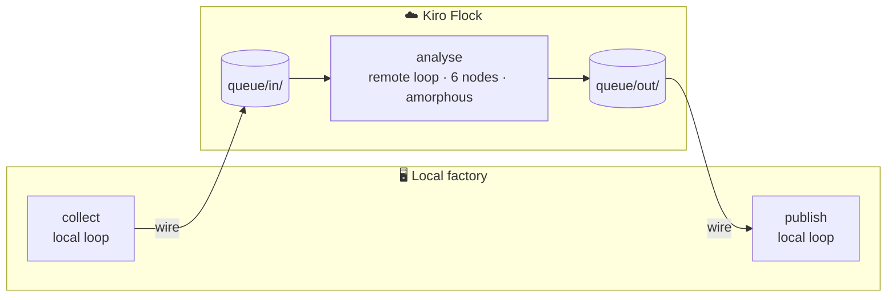
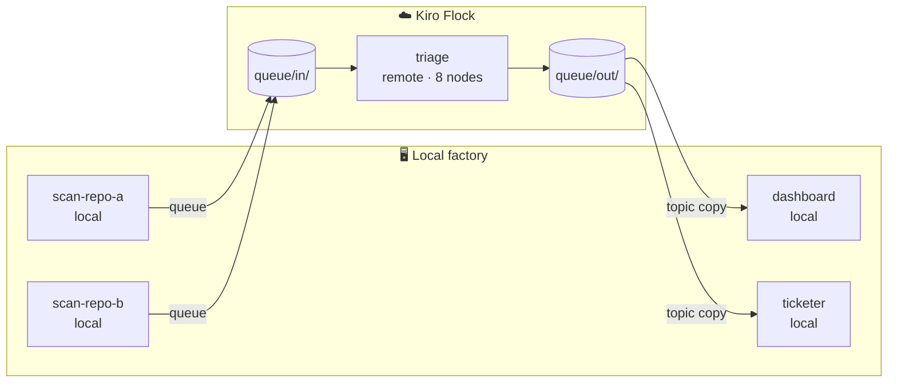
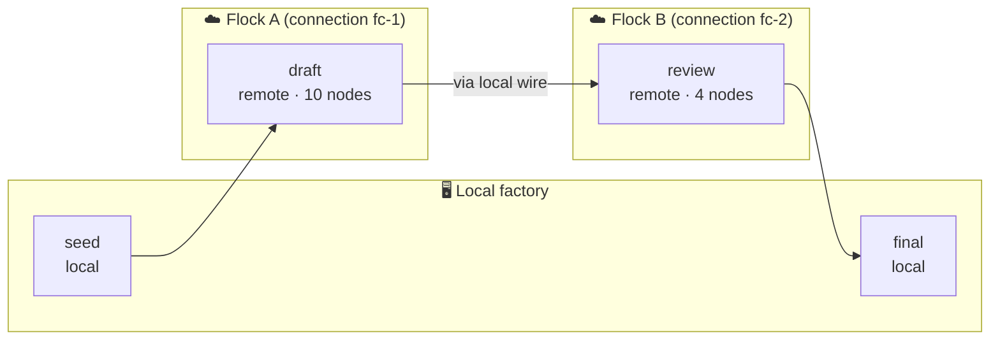
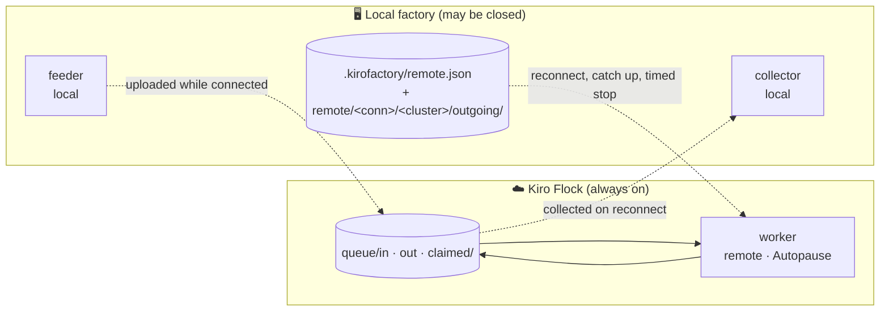
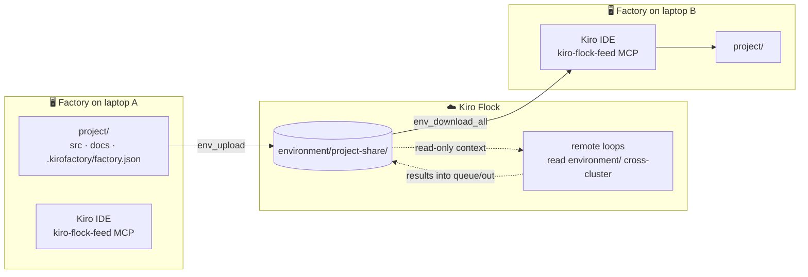

# How to use the Kiro Dark Factory: local and remote together

This guide covers the part that neither side documents on its own: a [Factory for Kiro](README.md) driving loops that run on a [Kiro Flock](https://github.com/aws-samples/sample-kiro-flock). It assumes you know what a loop, a wire and a queue are ([factory HOWTO](HOWTO.md)) and what a cluster, a direction and the S3 environment are ([flock README](https://github.com/aws-samples/sample-kiro-flock/blob/main/README.md), [flock howto](https://github.com/aws-samples/sample-kiro-flock/blob/main/kiro-flock-howto.md)). Each section shows the layout as a Mermaid diagram with the local floor on one side and the flock on the other, says what it is for, and gives a prompt you can hand to Kiro or paste into a loop. The single remote loop itself - its settings, its run modes, its cost - is in the HOWTO's [Remote flock loops](HOWTO.md#remote-flock-loops).

Two credentials appear throughout, and they are not the same thing:

| Who | Talks to | Signs in with |
|---|---|---|
| The factory (remote loops, queue bridge) | the flock's REST API | your Cognito user, stored as a refresh token in `~/.kirofactory/flock-secrets/` |
| The `kiro-flock-feed` MCP in your Kiro IDE (`env_*`, `coder_*`, `cluster_*`) | the REST API for cluster control, **S3 directly** for `env_upload`, `env_download_all` and the `coder_*` tools | Cognito for the API, your AWS profile for S3 |

So a machine that only runs the factory needs no AWS profile. A machine that uploads or attaches to the environment does.

[](resources/MultiClusterFactories.png)

*Section 2 running: a local loop fans out to four remote clusters, one per flock mode, and a local loop collects what comes back. Each remote card shows its node count, cost so far and the flock's state; the panel on the right is one node's live transcript.*

---

## 1. The bridge: local in, remote work, local out

The basic shape. A local loop produces items, a remote loop on the flock works through them, a local loop consumes the results. The factory moves items between its wire folders and the cluster's S3 queue folders; nothing else crosses the line.



### Description

`collect` writes one JSON item per thing to analyse into its output queue. The factory uploads each item to `environment/<cluster_id>/queue/in/`. Each of the six remote nodes reads the direction, takes an item by moving it to `queue/claimed/in/`, and writes a result to `queue/out/<itemId>--<seq>.json`. The factory downloads results to `publish`'s input wire and moves them to `queue/claimed/out/`. Nothing in `claimed/` is deleted; it is the trace of the run, readable in the flock dashboard's file panel.

The six nodes are an **amorphous** ring here: each reads its neighbours' recent log lines, which is what lets them split the inbox without being told who takes what. The mode select on the card offers the flock's other three: **mesh** (every node reads every other; fine up to a handful of nodes, noisy past that), **swarm** (each reads the K most recently active; for larger clusters where a full mesh is too much), and **single** (no peers at all). Single lets the node count go down to one, and more than one single node is that many independent runs of the same direction, a fire-and-forget worker pool; with queue items that works because the queue, not the neighbours, hands out the work. The card takes the flock's colour for the mode: purple, red, blue, green.

In the remote loop's prompt, `@input` and `@output` are rewritten to the S3 paths, so you write the prompt as for any local loop. The `@` menu on a remote loop offers the flock's words only: `@input`, `@output`, `@loop`, `@environment` (the cluster's folder on the flock, where `@project` would be), `@browser` and `@deploy` (naming one turns that tool on; `@deploy` lets the cluster create AWS resources in the flock's account, see the HOWTO), and the factory's parameters. `@project`, local MCP servers, skills and steering files are not offered and are refused at Start; the remote node has none of them (section 5 is how the project gets there).

Delivery downstream is **at least once**. Two nodes may take the same item, and a crash between writing a result locally and moving it on S3 can deliver it twice. `publish` should treat the item `id` as the key.

### Prompt

```
Build me a three-stage factory. Stage 1 is a local loop "collect" that lists every
.md file under docs/ and writes one item per file to @output with {"path", "title"}.
Stage 2 is a Remote loop "analyse" on my flock, 6 nodes, radius 1, that takes an item
from @input, reads nothing but the item (it has no checkout), writes a one-paragraph
critique of the title to @output as {"path", "critique"}, and marks the item claimed.
Stage 3 is a local loop "publish" that takes items from @input and appends them to
docs/CRITIQUES.md, skipping any id it has already written. Wire 1 -> 2 -> 3 as queues.
Run mode on "analyse": Autopause.
```

---

## 2. Fan-in and fan-out around a remote cluster

Several local loops can feed one remote cluster, and a remote loop's results can fan out to several local consumers as a topic. The factory does the fan-in and fan-out; the cluster sees one `in/` and one `out/`.



### Description

Two scanners on different local repositories write findings to the same remote loop. Eight nodes on the flock triage them. Every result is delivered as a topic, so `dashboard` and `ticketer` each get their own copy. Switching the remote loop's outgoing wires between queue and topic is the same panel control as for a local loop; the factory copies on download.

The node count has no local ceiling. The flock's own cap applies (`CONCURRENCY_CAP`, default 64) and its error is shown verbatim when you press Start.

### Prompt

```
Two local loops "scan-repo-a" and "scan-repo-b" each read their repo's TODO comments
and write one item per TODO to @output. Both feed a Remote loop "triage" (8 nodes) that
takes an item, assigns severity low/medium/high with one sentence of reasoning, and
writes it to @output. The triage output goes as a topic to two local loops:
"dashboard" appends to .scratch/triage.csv, "ticketer" creates a GitHub issue for
anything high, using the item id as the dedupe key in the issue title.
```

---

## 3. Remote to remote: the factory as the bus

Two remote loops never talk to each other on the flock. The factory carries items from one cluster's `out/` to the next cluster's `in/`, which means the two clusters can be on the same flock or on two different ones.



### Description

`draft` runs ten nodes on a large flock; `review` runs four nodes on a smaller, cheaper one in another account. The factory holds one connection per flock, and each remote loop names its connection. Items travel `draft out/` → local wire folder → `review in/`. The local hop costs one download and one upload per item and gives you a place to look at what passed between them: the wire's queue count on the card, and the files in `.kirofactory/queues/draft/`.

Use this when one flock should not hold another's credentials or data, when the two clusters need different task sizes or models, or simply to keep a second cluster off a flock that is near its concurrency cap.

### Prompt

```
Add a second flock connection for my eu-west-1 flock. Then build: local loop "seed"
writes 20 feature ideas to @output. Remote loop "draft" on the eu-central-1 connection,
10 nodes, large task size, writes a one-page spec per idea to @output. Remote loop
"review" on the eu-west-1 connection, 4 nodes, small task size, reads each spec and
writes {"id", "verdict", "notes"} to @output. Local loop "final" collects verdicts into
specs/REVIEW.md. All wires are queues.
```

---

## 4. Running unattended

The reason to run on the flock at all. Close the laptop; the cluster keeps working and the factory catches up when it comes back.



### Description

Three run modes exist on a remote loop: **Autopause**, **Run forever** and **After N hours**. `Auto stop` and `After N iterations` are not offered: the flock's answer to "the agents are done" is a pause rather than a stop, and there is no single iteration count across nodes.

- **Autopause** is the flock's own idle handshake, and the same field a local loop calls Wait for work. When every node reports idle for three iterations the cluster pauses. The factory wakes it when a new item lands in `in/`. **Paused is not free**: Fargate tasks keep running and billing; autopause saves model credits, not task time.
- **After N hours** records a `runUntil` in `.kirofactory/remote.json`. A factory that was closed past that time stops the cluster when it restarts. It fires on a paused cluster too.
- **Run forever** does what it says, until the zap or Delete.

The card has the flock's two verbs. **Pause** (where a local card has Stop) idles the nodes and keeps the tasks; Start on a paused cluster resumes it in seconds. The bolt is the **zap**: the flock's stop, tasks ended, billing over, queues and trace kept. `Stop all` pauses every remote cluster, `Force stop all` zaps them.

What survives a factory restart: the cluster, everything in `queue/`, the items the factory took from local wires but had not uploaded yet (`remote/<connection>/<cluster>/outgoing/`), and the sidecar entry that lets the factory recognise its own cluster (the `kf-` id plus a marker line at the top of the direction). On restart the factory reconnects, uploads the backlog, downloads whatever accumulated in `out/`, wakes an autopaused cluster if `in/` has items, and applies an overdue timed stop.

What does not survive: a refresh token older than 7 days. The card then says *Sign in to resume syncing. The cluster is still running.* Output piles up in `out/` until you sign in. For a run that must stay in sync for longer than a week, plan a sign-in once a week; the factory does not keep the password, because local loops run with shell access as you and could read it.

Before you walk away: open the connections dialog. It lists every live cluster on each flock with its cost estimate, including clusters a previous factory left behind. A cluster you paused is in that list too, still billing.

While the factory is attached, the settings and the direction are kept the same on both sides. Change the model, the interval, autopause or the direction on the flock's dashboard and the card follows within fifteen seconds; change them in the panel and the flock follows at once. Node count, mode, radius, K, task size and the browser flag travel the same way, and the flock applies them on the next start, as it does for its own dashboard. The rule is latest writer wins; a factory that reconnects after being away takes what the flock has, since that is what has been running. A direction edited on the flock comes back as the prompt with its `@input`-style words restored; a parameter's value stays as the value, since a value can occur anywhere in prose.

### Prompt

```
Set the "worker" remote loop to Autopause and give the connection a remembered
password so it can sync past a week. Then show me the connections dialog so I can
check nothing else is running or paused on that flock before I leave for the weekend.
```

---

## 5. Sharing the project with the flock: `env_upload` and `env_download_all`

A remote node has no checkout. It sees the direction, its inbox, its scratch folder and whatever else is under `environment/`. That last part is the lever. The loop's own folder is `environment/<cluster id>/`, which the prompt names as `@environment`, and the id is on the remote bar from the moment the loop has a connection (click it to copy). Upload the project there and the prompt can say `Read @environment/project/`. Reads across `environment/` are also cross-cluster by design, so a project uploaded once under a shared prefix is visible to every remote loop on that flock. The same mechanism moves a project between two factories on two machines.



### Description

`env_upload` takes a local file or folder and puts it under `environment/<cluster_id>/[key]`. Two places to put a project:

- **The loop's own folder.** Copy the `kf-…` id from the remote bar, upload with that `cluster_id` and `key: project`, and write `Read @environment/project/ for the project; do not write there.` in the prompt. One loop, one folder, nothing to spell out. The copy lives and dies with the loop: Delete with "remove files" takes it along.
- **A shared prefix.** Give `env_upload` a cluster id that is not one of your loops, say `project-share`, when several remote loops need the same project or it should outlive any one of them. The prompt then names the path in full: `Read /environment/project-share/ for the project.`

Environment files are not wiped by a cluster start, so upload before or after.

What to upload. `factory.json` under `.kirofactory/` is the design and travels fine; it carries only a connection *id* for remote loops, never a token. Leave out `.kirofactory/queues/`, `topics/`, `remote.json`, `remote/` and `worktrees.json`: they are machine-local state and a second factory reading them would collect items the first one already took. Also leave out `node_modules/` and anything you would not commit.

`env_download_all` zips `environment/<cluster_id>/` (or all clusters when omitted) to a local path. On laptop B, unzip into a directory, open it as a factory, and the loops, wires and remote loop definitions are there. The remote loops will say *connection not found* until B adds its own connection to the same flock; connection ids are per machine on purpose. Once B is connected, its remote loops get **new** cluster ids (the id hashes connection, factory and loop), so B never adopts A's running cluster. That is the safe default; to hand over a running cluster, stop it on A and start it on B, with the queue contents intact in S3 if you upload them as part of the share.

This is a documented use of existing tools, not a tested workflow; the first time through, check the zip before you trust it.

### Prompt

```
Using kiro-flock-feed: upload this project folder to my flock under cluster id
kf-3fa9c21d (copied from the "analyse" remote loop's bar) with key "project",
excluding node_modules, .git, and everything under .kirofactory except
factory.json. I will add "Read @environment/project/ for context; never write
there." to the loop's prompt myself.
Later, on my other laptop: download environment/kf-3fa9c21d as a zip into
~/FactoryProjects/analyse-share.zip and unpack it so I can open it as a factory.
```

---

## 6. Attaching to a remote loop: `coder_attach`

`coder_attach` downloads `environment/<group>/` into a local folder and keeps a sync state beside it, so you can open the folder in your IDE and work next to the agents with `coder_pull`, `coder_push`, `coder_status` and `coder_log`. The tool documents `group` as an `everforgeGroup`, but it builds the prefix literally as `environment/<group>/`, and a remote loop's prefix is `environment/<kf-id>/`. Click the cluster id on the remote bar to copy it (it is there before the first Start), pass it as the group, and you are attached to that loop.

```mermaid
graph LR
    subgraph Local["🖥 Operator"]
        IDE[Kiro IDE<br/>coder_attach kf-3fa9c21d → ./attached/]
        FAC[Factory<br/>drives the same cluster]
    end
    subgraph Flock["☁️ Kiro Flock · environment/kf-3fa9c21d/"]
        Q[(queue/in · out · claimed/)]
        L[(loop/agent-N/<br/>scratch per node)]
        CL[(coder-log.md)]
        R[remote nodes]
    end
    FAC <--> Q
    IDE -- coder_pull --> Q & L
    IDE -- coder_push / coder_log --> L & CL
    R -. read coder-log.md .-> CL
    R <--> Q & L
```

### Description

After attaching you have the live queues and every node's scratch folder on disk. Useful for three things:

- **Watching.** `coder_pull` shows the items waiting in `in/`, the results in `out/` before the factory collects them, and what each node is building in `loop/agent-N/`.
- **Steering mid-run.** `coder_log "Stop reformatting the markdown, the consumer wants raw JSON"` writes to `coder-log.md`, which agents read. The factory's own steer path pushes a new direction; this is the lighter touch for a hint rather than a rewrite.
- **Fixing in place.** Edit a node's scratch output and `coder_push` it with a message. Push refuses to overwrite a remote file that changed since your last pull and reports the conflict, so you do not trample a node mid-write.

Do not push into `queue/`. The factory and the nodes own those folders; a file in `out/` that is not JSON is parked by the factory in `queue/rejected/` with a line in the Bridge log, and a hand-written file in `in/` is taken by a node as if the factory had sent it. Do not delete under `claimed/` either; it is the trace. `coder_detach` clears the sync state and leaves the local files, so a detached folder is a snapshot you can keep.

Several clusters at once: the factory already puts each remote loop under its own prefix, so one attach per loop. The flock's group mechanism (`everforgeGroup`) is not used by remote loops, which is why there is no single prefix covering a whole factory.

### Prompt

```
I copied cluster id kf-3fa9c21d from the "analyse" remote loop's bar. Attach me to
it with coder_attach into ./attached/analyse, pull, and show me what is in queue/in
and in each node's scratch folder. Then write a coder_log telling the nodes that
results must be valid JSON with a top-level "payload" key, nothing else.
```

---

## Quick comparison

| Shape | Remote loops | What crosses the line | Best for |
|---|---|---|---|
| 1. The bridge | 1 | queue items both ways | moving one heavy stage off the laptop |
| 2. Fan-in / fan-out | 1 | items from N producers, copies to M consumers | one expensive cluster shared by several local stages |
| 3. Remote to remote | 2+ | items, via a local wire | separate flocks, accounts, sizes or models per stage |
| 4. Unattended | any | items, reconnect state | overnight and multi-day runs |
| 5. Project share | 0 or more | the project folder, as a zip | giving nodes the project; syncing two factories |
| 6. Attach | 1 per attach | files under the cluster prefix | watching, hinting, fixing in place |

## What the two sides each own

| | Local factory | Kiro Flock |
|---|---|---|
| The prompt | written in the panel | stored as the cluster direction, re-read every iteration |
| Items | `.kirofactory/queues/<producer>/` | `environment/<kf-id>/queue/{in,out,claimed}/` |
| Loop scratch (`@loop`) | `.kirofactory/loops/<loopId>/` | `environment/<kf-id>/loop/agent-N/` |
| Lifecycle | Start / Resume, Pause, Zap (the bolt), Delete, timed run mode | runs regardless of the factory's state |
| Credentials | Cognito refresh token (7 days; the password is never stored); can start clusters with `trust deploy` | agent IAM role, bucket-scoped; deployer role on `trust deploy` clusters, bounded by the flock's `kflock` bootstrap |
| Cost | model credits | model credits plus Fargate time, including while paused |
