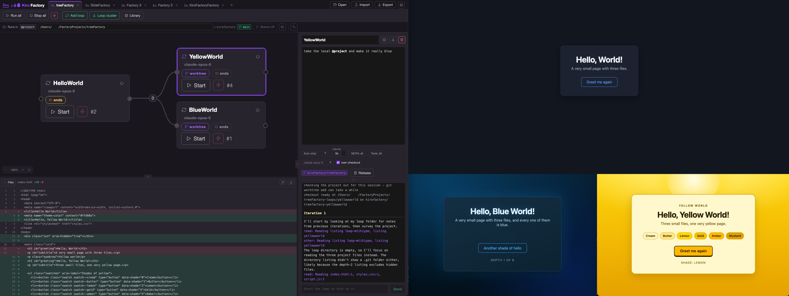

# Kiro as a Software Factory

**Graph engineering for Kiro: a factory of agent loops.** A loop is a prompt that runs turn after turn as a `kiro-cli` session. You place loops on the factory floor, wire them together, and press start. The wires are folders on disk: one loop writes a file, the next one picks it up atomically. Queues, topics and clusters shape the graph, each loop runs under an enforced tool grant, and it all lives in a directory you point it at. That is the whole system.

Every loop is a [Kiro](https://kiro.dev) session, which is where the name is earned rather than borrowed.

## The factory

[](resources/kiro-factory-screen.png)

## Run it

This is sample code, for non-production usage. You should work with your security and legal teams to meet your organizational security, regulatory and compliance requirements before deployment.

```bash
./setup.sh   # install and build, once
./run.sh     # build and serve
```

Then open `http://127.0.0.1:4711`. [Kiro CLI](https://kiro.dev/docs/cli/installation/) **3.0 or newer** needs to be on your PATH, since every loop is a `kiro-cli` session on the V3 harness; the factory was developed and tested against **3.2**. The server checks the version at startup and says so if it is older. Node 20.19 or newer (or 22.12+).

Set `LOOP_DRIVER=echo` to run the machinery without calling a model, which is useful for watching how work moves without spending anything. `PORT` and `HOST` move the server, and the rest of what can be set is in [the HOWTO](HOWTO.md#environment).

## The model, in one paragraph

A loop is a name and a prompt; each turn is a fresh Kiro session, so its memory is what it leaves on disk. A wire is a folder: an item is a small JSON file, and taking one *moves* it out - the rename is atomic, so two loops racing for the same item cannot both get it. The move is the agent's own `mv`, which is why a consumer needs `shell`; the default grant has it. A producer's wires deliver as one shared **queue** or as a **topic** with a copy per subscriber. A component can be a **cluster** instead of a single loop, running the same prompt in several sessions at once which compete over that one queue, optionally reading each other around a ring. A loop takes turn after turn until you stop it, or until the run mode you picked ends it: when its agent judges the work finished, when the queue runs dry, or at a cap on turns or hours. Every factory runs in a base directory, its loops write anywhere below it, and the directory bar says what git makes of that - including branching a factory off into its own worktree, or giving every session of one loop a checkout and a branch of its own so parallel work is genuinely parallel.

Prompts are written with `@names`: `@input` and `@output` for the queues, `@project` and `@loop` for the directories, `@some-server` for a tool, and a name of your own for a **parameter** - a value set once on the directory bar that every prompt in the factory can write, and that can be changed between runs without editing a prompt.

A cluster can also be **remote**: the same card, running as a cluster on a Kiro Flock you already have, with the factory moving items between your wires and its S3 and the cluster running on after this app is closed. That is the [dark factory](#kiro-dark-factory), below.

The full tour - queues and topics, how a run ends, clusters, remote flock loops, scoping a loop's tools and model, parameters, a checkout per session, the file and changes panels, prompts, the library, what lands on disk - is in **[HOWTO.md](HOWTO.md)**. Reusable loops, clusters and whole factories live in [`library/`](library/).

## What a loop is trusted with

**A new loop starts with every built-in tool except one, and with no MCP servers.** The grant a loop is born with is `read`, `write`, `search`, `code`, `shell`, `web`, `knowledge`, `todo_list` and `introspect` - nine of the ten the panel offers - and **no MCP servers**. `shell` is in because the factory model needs it: taking an item off a queue is a move, `write` can create, edit and delete a file but not rename one, and a consumer that cannot move an item cannot claim it. An earlier default left `shell` out as the blast radius, and what it bought was a default at which no loop could take part in a queue. `subagent` is the one row left out: it is a way to get a second agent whose own grant nobody has looked at, and it is the tick this default exists to make you make on purpose. MCP servers are out because they are where credentials tend to live, and because a prompt that names one with `@` gets it anyway.

The grant is enforced, not requested. It is handed to `kiro-cli` as the generated agent's tool list, so a loop without `shell` does not have one - the agent cannot decide otherwise.

**So read the default for what it is.** A loop at the shipped grant can run `npm run build`, `git commit`, a migration, or `rm -rf`, inside the directory you pointed it at and with the credentials of the shell that started the server, and nobody will ask you first. The [`KiroFactoryFactory`](library/factories/kirofactoryfactory.json) in the library compiles this app at that grant, which is the point; it also means the directory you give a factory should be one you would give an unattended contractor with a terminal. Narrow a loop that does not need commands - the one that only rewrites text - by opening `Tools` and unticking `shell`; it will then have none.

**The panel tells you this the first time.** A loop still carrying the grant it was born with shows a small note above its `MCPs` and `Tools` chips - *Set which tools and MCP servers this loop may use*, with a `Keep` beside it. It appears for a loop you add and for every loop of a factory you take out of the library, and it names only the half you have not decided yet. Clicking the note, or opening either list, puts it away for that loop. Clicking `Keep` says the default is fine: it saves the shipped grant as your default for each half you had not decided, and the note does not come back on any loop on this machine. Nothing enforces that you read it; it exists so that the grant a loop runs with is something you saw once.

**If the default is wrong for the way you work, change it once.** Set a loop's `Tools` or `MCPs` to what you actually want and a `Save as default` appears above that chip; click it and every new loop starts there. The two are saved separately - keeping your servers says nothing about your tools - and the choice is yours rather than the project's: it lives in `~/.kirofactory/grants.json` and applies in every factory you open on this machine, so a factory you export carries no opinion about what somebody else's agents may do. Saving also silences the note, on the reasoning that somebody who has set a default has thought about the question; `Keep` is the same act for somebody whose answer is the shipped grant. `Tools: all` is a legitimate thing to save, and the point of saving it is that it becomes a decision somebody made rather than the absence of one. To go back, remove that key from `grants.json` - or delete the file for both - which returns the axis to the shipped grant and brings the note back with it.

The ten grants are read, write, search, code, shell, web, subagent, knowledge, todo_list and introspect; tick a loop down to any of them and it gets exactly those. The same applies to MCP servers, per loop, with one exception worth knowing: a server the prompt names with `@` is granted whether or not the list mentions it, because a prompt that says `@pricing` must never run against an agent that does not have it. See [the HOWTO](HOWTO.md#what-a-loop-may-use).

What is *not* configurable from the UI is approval, and this is the reason the grant matters as much as it does. Within whatever a loop has been granted, calls run unattended: **no human confirms a write, a shell command or a delete mid-run.** That is what makes it a loop rather than a chat, and it means a running loop should be read as something holding your shell inside its working directory. Point factories at a dedicated, version-controlled directory, and expect files there to be created, changed and removed without being asked. Auto-approval is a flag and a kind list at the top of `app/server/acp.ts` if you want a narrower default for every loop at once.

**Loops inherit the environment of the shell that started the server.** Anything exported there - cloud credentials, API tokens - is visible to every agent the app runs. Start it from a shell that holds nothing you would not hand to an unattended agent, and in particular not one carrying production credentials.

**A remote loop holds a flock login.** Connecting a [Kiro Flock](https://github.com/aws-samples/sample-kiro-flock) stores a Cognito refresh token for it under `~/.kirofactory/flock-secrets/` (mode `0600`); the password is used for the one sign-in call and never written. That credential can start, stop and write to any cluster on that flock, including clusters with `trust deploy` on, and the factory uses it unattended for the clusters it created. Its agents run on the flock with the flock's own tools and nothing from this machine, and they keep running when this app is closed; only the zap (the bolt), Delete or a timed run mode ends one, and Pause keeps the tasks billing. See [the HOWTO](HOWTO.md#remote-flock-loops).

**A remote loop with `trust deploy` creates AWS resources.** Tick it in the loop's Tools menu (the only thing that turns it on: `@deploy` in the prompt does not, Import and Reload drop the flag from a document, and the card shows a `trust deploy` chip before Start) and the cluster's nodes may run `cdk deploy` into the flock's account through the flock's Deploy MCP: stacks, buckets, functions, whatever the prompt asks for, billed to that account and left running until the stack is destroyed (the flock dashboard's destroy action, or the stack's owner). The flock bounds what such a stack may contain (its own scoped bootstrap, tag-scoped deploy role, a permissions boundary on every role the stack creates) and tags every stack it deploys, so it is a feature to use on purpose in an account meant for it, not one to leave on by default. A deployer deploys what the clusters in its `environment/` group wrote, and all remote loops of one factory share a group named after the factory: that shared folder is how clusters collaborate, so while a deployer runs, start only the loops that belong to that work.

## The agent reads the project, and the project can talk back

Skills and steering files under the project directory are read fresh every turn and loaded into the agent's context. That is the feature: a repository can teach the loops working on it. It is also the exposure, because those files are instructions and they are not yours if the repository is not yours. **A `SKILL.md` or a steering file in a cloned third-party project can steer a loop that holds shell and delete.** Point factories at code you trust, or run the whole thing in a container where the blast radius is one you chose.

The same caution applies to anything a loop *fetches* or reads out of a queue: text arriving from outside the factory is data, not instruction, but an autonomous agent is the wrong place to be relaxed about the difference.

`@loop` and `@project` scope the directories a prompt talks about, and `@names` scope tools. Both are stated to the agent, and the tool grant is enforced by `kiro-cli`, but the directory scoping is a request in a prompt rather than a sandbox: nothing stops a granted shell from walking somewhere else on disk. Treat the working directory, and the environment the server was started from, as the real boundaries.

## Kiro Dark Factory

<p align="center">
  
</p>

> **BETA.** The remote side is sample code under active development. It has been run end to end by its authors against their own flocks. Expect rough edges, expect the design to move, and do not point it at anything you cannot afford to lose. Every agent it runs works unattended with shell access, and a remote cluster bills until it is stopped.

A dark factory is this factory with at least one **remote loop**: a loop cluster on the floor whose nodes are Fargate tasks on a [Kiro Flock](https://github.com/aws-samples/sample-kiro-flock). The factory draws the pipeline and moves the work, the flock runs the agents in the cloud, and the cluster keeps running when your laptop is closed. Same card, same `n1..nN` strip, same panel. The prompt is the cluster's direction, the queues are the cluster's S3 folders, and the factory moves items between your wires and those folders. Closing the browser, quitting the factory, restarting it or a sleeping laptop never stops a remote cluster; only the zap (the bolt, which is the flock's stop), Delete, or a timed run mode you chose do. The card's other button is Pause, the flock's own verb, and Start resumes.

The flock lives in this repository as the git submodule [`kiro-flock/`](https://github.com/aws-samples/sample-kiro-flock), pinned to the commit the factory was tested against. You need it only to **deploy** a flock; the factory itself imports nothing from it, and the mock flock below needs no AWS at all.

```bash
git clone --recurse-submodules <this repository>
# or, in an existing clone:
git submodule update --init
```

### Deploy the flock

Prerequisites: an AWS account and profile, Node 20.19 or 22.12 or later, `kiro-cli` 3.0 or newer (the agents in the cloud run their own pinned copy, 3.2.0, see the flock README), and either `finch` or `docker` for the agent image. The flock deploys with CDK into your account; the factory runs on your machine.

```bash
cd kiro-flock
cp install.config.template install.config    # set REGION, PROFILE, USERNAME
./setup.sh
```

`setup.sh` deploys the stack, creates your Cognito user, and prints the dashboard URL. That URL is the API URL you give the factory. A flock deployed from an older checkout needs redeploying from the submodule's commit: the factory checks for the three scoped queue routes (`env-list`, `env-put`, `env-delete`) and says `needs flock update` until it finds them.

### Connect them

Run the factory as above. The gear beside **Remote loop** opens the connections dialog: enter the flock's API URL, your Cognito username, password and the code from your authenticator app (the flock's user pool requires MFA; enroll the authenticator by signing in to the flock dashboard once). The factory reads the flock's `auth-config.json`, signs in once through the AWS SDK's Cognito client (`USER_PASSWORD_AUTH`, then the `SOFTWARE_TOKEN_MFA` challenge), and keeps the refresh token in `~/.kirofactory/flock-secrets/` (mode `0600`). The password and code are used for that one sign-in and not stored. The refresh token lasts 7 days; after that a remote loop shows `signed out` until you sign in again, and nothing on the flock is touched in the meantime.

Then **Remote loop** places a card. Pick how the nodes talk to each other (the flock's `amorphous`, `mesh`, `swarm` or `single`; the card takes the flock's colour for it), how many nodes, write the prompt as for any loop (the `@` menu offers the flock's words: `@input`, `@output`, `@loop`, `@environment`, and `@browser` or `@deploy`, which turn that tool on when named), wire it, press Start. The bar above the node strip shows the cluster id (click to copy; it is there before the first Start), state, cost and an **Open Kiro Flock** link to the flock's own dashboard. While the factory is attached, settings and direction are kept the same on both sides: an edit on the flock's dashboard shows up on the card, an edit in the panel reaches the flock. One thing to know: a direction edited **on the flock** comes back into the prompt with parameters flattened to their values. `@share` went out as `environment/project-share/`, and that is how it comes back, because a value can appear anywhere in prose. The prompt then no longer follows the parameter. Edit prompts that use parameters in the factory, not on the flock dashboard; `@input`, `@output`, `@loop`, `@environment`, `@browser` and `@deploy` are restored either way.

The HOWTO's [Remote flock loops](HOWTO.md#remote-flock-loops) covers the single remote loop: what a remote node has and does not, the modes, the queue folders and the at-least-once rule, signing in, cost, and security. [**DARK-FACTORY.md**](DARK-FACTORY.md) covers the shapes you build from several, with diagrams: fan-in and fan-out, remote-to-remote chains, unattended runs, sharing a project with the flock through `env_upload` and `env_download_all`, and attaching to a remote loop with `coder_attach`. The [`KiroFactory-skill`](.kiro/skills/KiroFactory-skill/SKILL.md) has a dark factory part for designing one with Kiro.

### Without AWS

The factory ships a mock flock for trying the feature with nothing deployed:

```bash
cd app
npm run mock-flock
# in another shell:
KIROFACTORY_INSECURE_FLOCK=1 KIROFACTORY_COGNITO_ENDPOINT=http://127.0.0.1:19840/cognito npm run dev
```

Connection: API URL `http://127.0.0.1:19840/prod`, any username, password `flock` (with the mock's `mfa` switch on, authenticator code `123456`). The mock's agents move items through the queues on a timer and write canned transcripts.

### What to know before you trust it

- **Agents run unattended**, locally with shell access in the factory's base directory, remotely with the flock's tool set and write access to the cluster's S3. See [what a loop is trusted with](#what-a-loop-is-trusted-with).
- **A remote cluster bills until zapped.** Paused is not free, whether you pressed Pause or autopause did: Fargate tasks keep running. Only the bolt ends them. The card shows the flock's cost estimate; the connections dialog lists every live cluster on each flock, including ones left running by a closed factory.
- **The factory holds a flock login** as capable as yours. It uses it only for clusters it created, except in the orphan list, which asks first.
- **Results from a remote cluster are untrusted input.** Any agent on the flock can write them, and local loops act on them with shell access. The factory accepts a result only under a filename-safe id, drops any `artifact` path a remote result names, and parks anything else in the cluster's `queue/rejected/`; the payload itself still reaches the next loop as data, and that loop's prompt says to treat it as such.
- **Delivery is at least once.** A consumer downstream of a remote loop should treat the item `id` as the key.

### Working on both

The submodule is an ordinary checkout of its branch. Commit and push inside `kiro-flock/` as usual, then `git add kiro-flock` here and commit to move the pin. Tests:

```bash
cd kiro-flock/kiro-flock-cluster && npm test && npx tsc --noEmit -p .
cd app && npm test && npm run typecheck && npm run build
```

## The server

The server binds loopback, which is most of what stands in for authentication: only this machine can reach it. Three things cover the rest, since "this machine" includes the browser tab next to this one and every other process on the box.

Requests must arrive with a loopback `Host`, and must not carry a foreign `Origin` or a cross-site `Sec-Fetch-Site`, so a page on another site cannot drive the API and a rebound DNS name cannot pretend to be local. Anything that changes something must also carry an `x-kirofactory` header holding **a token generated fresh at every start**, which the server writes into the page it serves and prints on the console. A page from elsewhere cannot set that header at all, and another process on this machine cannot guess the token. Reads are not asked for it - an export link and an event stream cannot send headers, and a process running as you can read those files without asking us to. And `HOST` alone will not publish the server: a non-loopback bind is refused unless `KIROFACTORY_ALLOW_REMOTE=1` says so too.

Restarting the server invalidates open tabs, which they handle by reloading themselves once to pick up the new token. To drive the API by hand, copy the token from the startup output.

Even so, this is a local development tool. There is no user model and no audit trail, and the endpoints start agents. It is not meant to be exposed to a network, and putting it on one puts unattended shell access there with it.

## License

Apache License 2.0. See [LICENSE](LICENSE).

**Author:** Ivo Kammerath<br>
**Reviewer:** Ben Freiberg, Martin Karrer
